<div align="center">

# ☕ Chatpuccino

**Roleplay con IA que se siente como chatear en tu app de mensajería favorita.**

Tus personajes, tus historias y tus modelos, en una app web que corre en tu propio equipo.


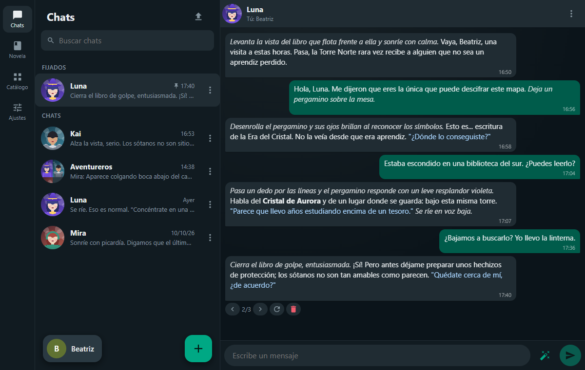

</div>

## ¿Qué es Chatpuccino?

Chatpuccino es una aplicación de chatbots para roleplay inspirada en [SillyTavern](https://github.com/SillyTavern/SillyTavern), pero con una interfaz basada en las aplicaciones de mensajería modernas: lista de chats, burbujas, fijados, grupos y un diseño que funciona igual de bien en el móvil que en el escritorio.

- **Tus datos son tuyos.** Todo vive en archivos en tu equipo (`.jsonl`, `.png`, `.json`). Lo único que sale de tu máquina son las peticiones al proveedor de IA que tú configures.
- **Compatible con SillyTavern.** Tarjetas de personaje PNG (V2/V3), lorebooks (World Info), presets de Chat Completion y chats `.jsonl`: los traes y los llevas sin conversión.
- **Cualquier modelo.** OpenRouter (con favoritos y lista de modelos) o servidores locales compatibles con OpenAI como LM Studio u Ollama.
- **Se instala en un minuto.** Node + React, sin base de datos ni servicios externos. Funciona en Windows y Linux.

## 💜 Proyecto de código abierto

Chatpuccino es un proyecto **open source**, hecho en comunidad y para la comunidad del roleplay. El código es público, lo puedes leer, modificar y adaptar a tu manera, y **las contribuciones son bienvenidas**: desde reportar un fallo o proponer una idea hasta enviar un *pull request*. Mira [Contribuir](#contribuir) para empezar.

> Chatpuccino es un proyecto independiente: se inspira en SillyTavern y es compatible con sus formatos, pero no está afiliado a él.

## ✨ Características

| | |
| --- | --- |
| 💬 **Estilo mensajería** | Chats con burbujas, marcas de hora, chats **fijados**, búsqueda y chats ilimitados por personaje; cada uno con su propia historia. |
| 👥 **Grupos** | Varios personajes en la misma conversación, con respuesta inteligente (el mencionado o el siguiente por turnos), todos a la vez o manual; y puedes convertir un chat individual en grupo. |
| 🎭 **Personajes** | Crea, edita e importa tarjetas PNG/JSON de SillyTavern. Arrastra una imagen para crear uno nuevo, organízalos con **etiquetas** (se eligen de un desplegable con las que ya usas o se crean con «+») y abre la tarjeta desde el chat con solo tocar su nombre. Un **asistente de IA** (✨) genera, mejora, expande o reescribe cada bloque de texto y describe el aspecto del personaje leyendo su imagen. |
| 🗂️ **Catálogo** | Una sección propia con todo lo que creas y reutilizas: personajes, personas, etiquetas, lorebooks, fondos, sprites y estadísticas, en pestañas. |
| 🙋 **Personas** | Tu representación en la historia, intercambiable al vuelo desde la esquina de la lista de chats. |
| 📚 **Lorebooks** | Editor de World Info compatible con SillyTavern para dar contexto adicional al modelo. |
| 🎛️ **Presets y prompts** | Lista ordenada de prompts, parámetros de muestreo y formatos guardados en JSON, con inspector del prompt final. |
| 🔀 **Control de la conversación** | Variantes (*swipes*) que puedes borrar una a una, ramas desde cualquier mensaje, copiar chats e **impersonar** (el modelo escribe por ti). |
| 🎨 **Personalización** | Modo claro/oscuro/automático, colores, fuentes, tamaños, transparencia de burbujas y fondo de pantalla. |
| 🔐 **Seguridad** | Inicio de sesión con contraseña cifrada (scrypt), bloqueo ante intentos fallidos y cierre de sesiones. |
| 📖 **Modo Novela** | Roleplay como novela visual: **Mundos** con escena, sprites por expresión y atuendo (sistema de SillyTavern), fondos, **estadísticas** que cambian con la historia (con notificaciones) e influyen en los personajes, y una interfaz pensada para escritorio y móvil. |
| 🖼️ **Estudio de imágenes** | Conecta tu servidor de **Stable Diffusion** para generar imágenes de personajes, **expresiones con inpaint** (solo la cara), fondos y quitar el fondo, listos para el Modo Novela. |
| 📱 **Móvil y escritorio** | Diseño responsivo pensado primero para el pulgar. |

## 📸 Capturas

<table>
  <tr>
    <td align="center">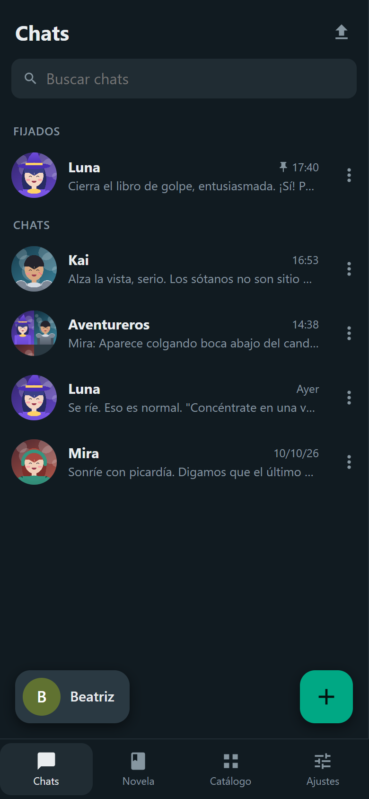<br><sub>Lista de chats con fijados</sub></td>
    <td align="center">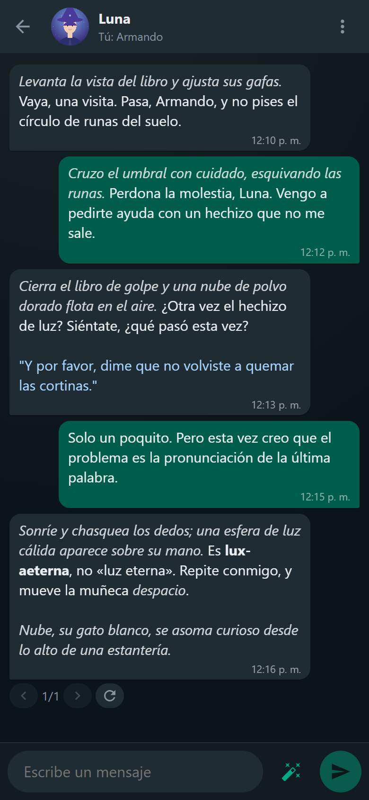<br><sub>Modo oscuro</sub></td>
    <td align="center">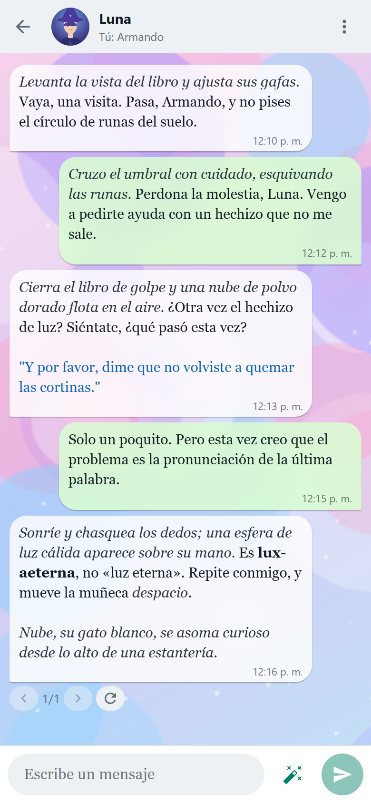<br><sub>Modo claro, fondo y burbujas translúcidas</sub></td>
  </tr>
</table>

<table>
  <tr>
    <td width="68%">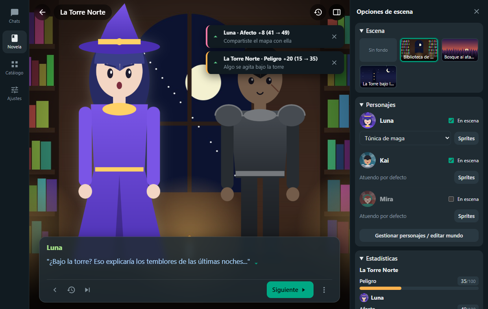<br><sub><b>Modo Novela</b> en escritorio: escena con sprites, diálogo, opciones de escena y notificaciones cuando cambia una estadística.</sub></td>
    <td width="32%" align="center">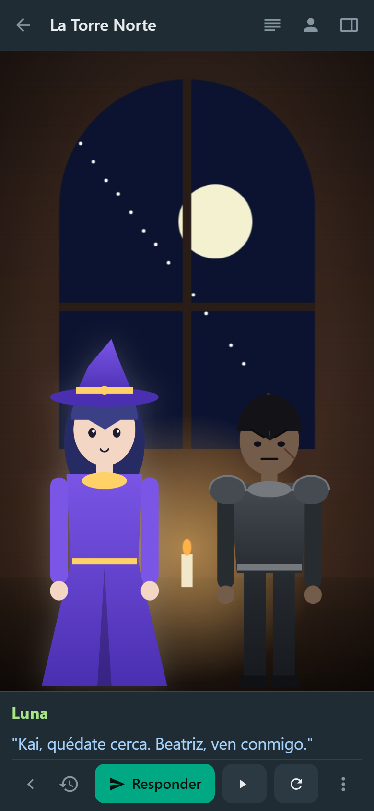<br><sub>Y en el móvil, con foco en el texto o en el personaje.</sub></td>
  </tr>
</table>

<table>
  <tr>
    <td width="50%">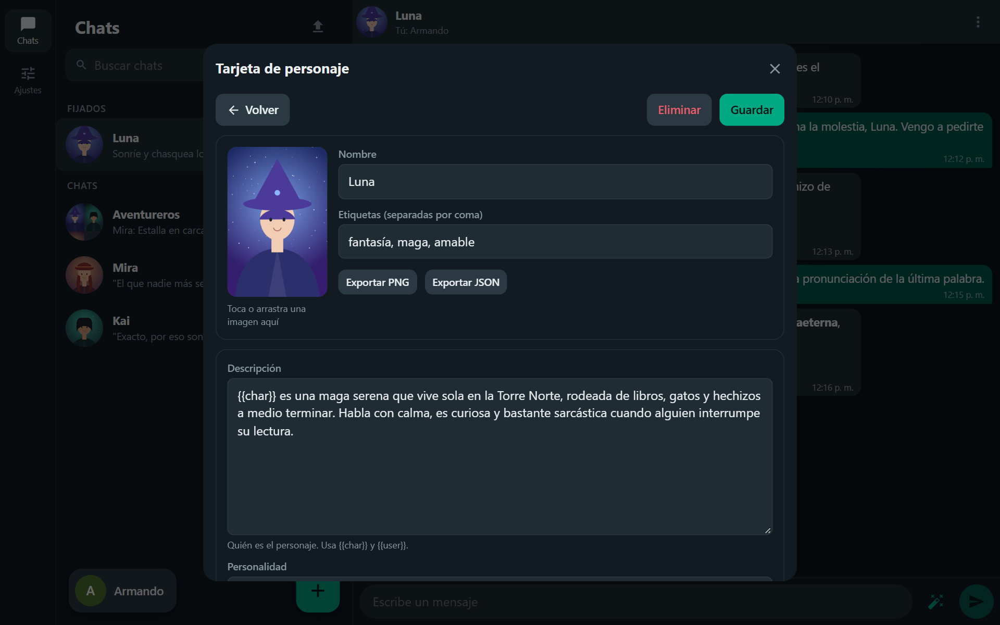<br><sub><b>Tarjeta de personaje</b> editable desde el propio chat.</sub></td>
    <td width="50%">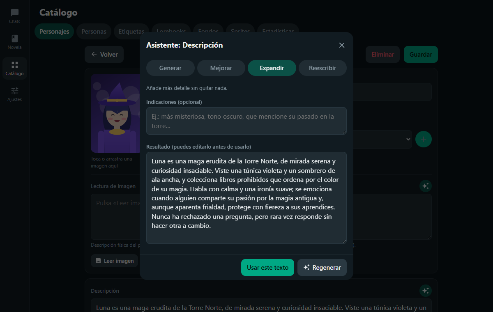<br><sub><b>Asistente de IA</b> (✨) para generar, mejorar, expandir o reescribir cada texto.</sub></td>
  </tr>
  <tr>
    <td width="50%">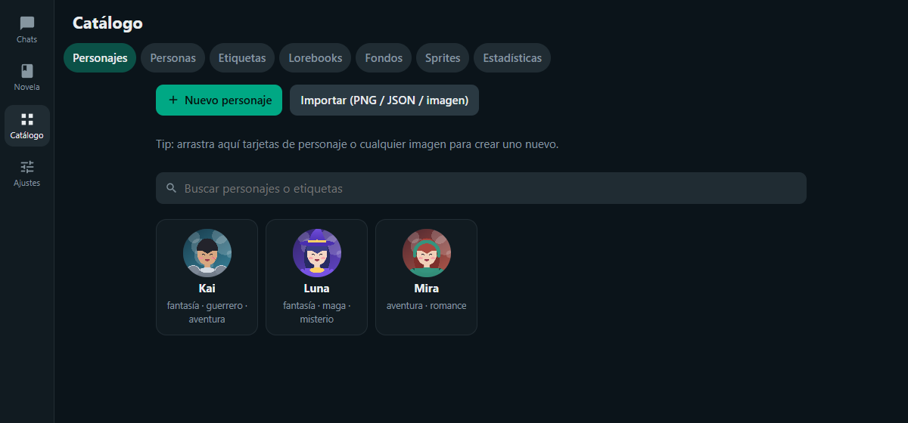<br><sub><b>Catálogo</b>: personajes, personas, etiquetas, lorebooks, fondos, sprites y estadísticas en un solo lugar.</sub></td>
    <td width="50%">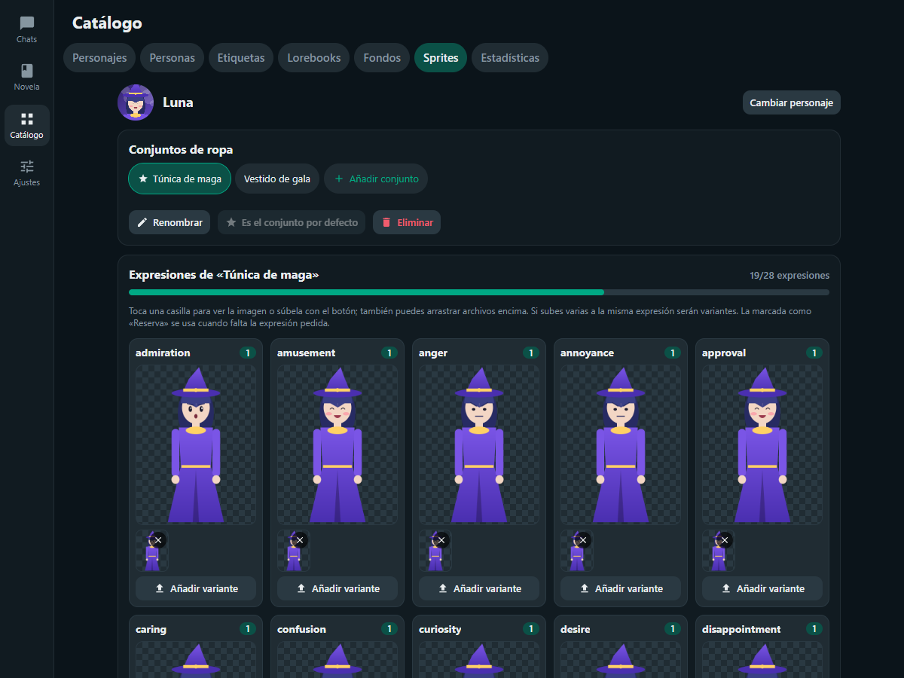<br><sub><b>Sprites</b>: conjuntos de ropa y una imagen por expresión, como en SillyTavern.</sub></td>
  </tr>
  <tr>
    <td width="50%">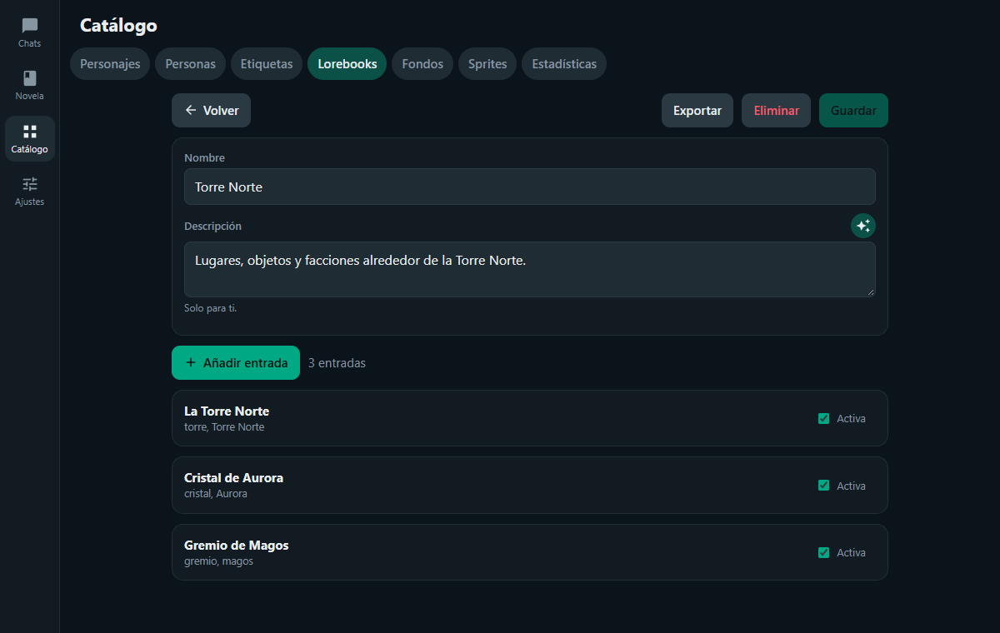<br><sub><b>Lorebooks</b> en formato World Info de SillyTavern.</sub></td>
    <td width="50%">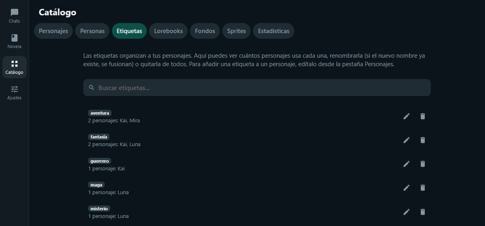<br><sub><b>Etiquetas</b>: renómbralas, fusiónalas o quítalas de todos los personajes.</sub></td>
  </tr>
  <tr>
    <td width="50%">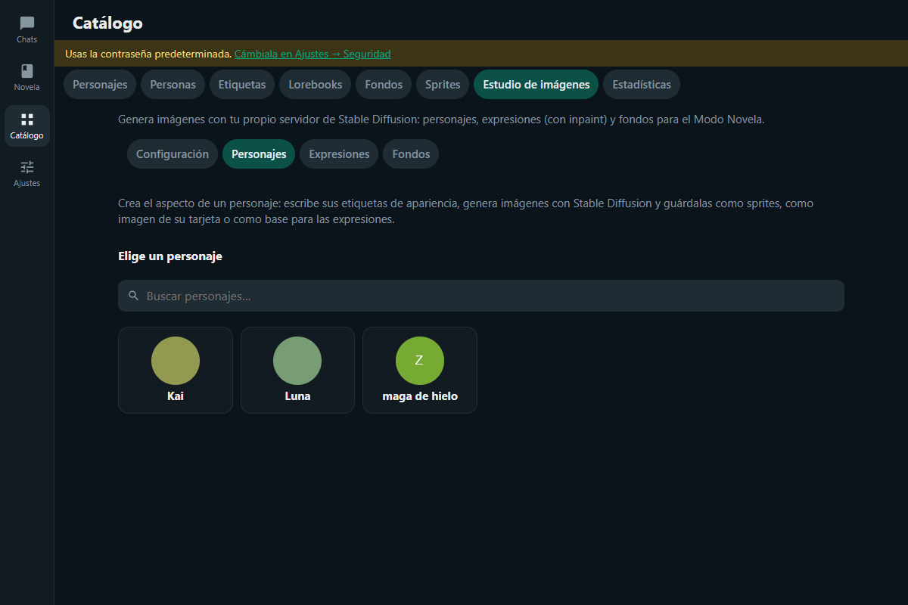<br><sub><b>Estudio de imágenes</b>: parámetros con barras deslizantes y un perfil por tipo de imagen.</sub></td>
    <td width="50%">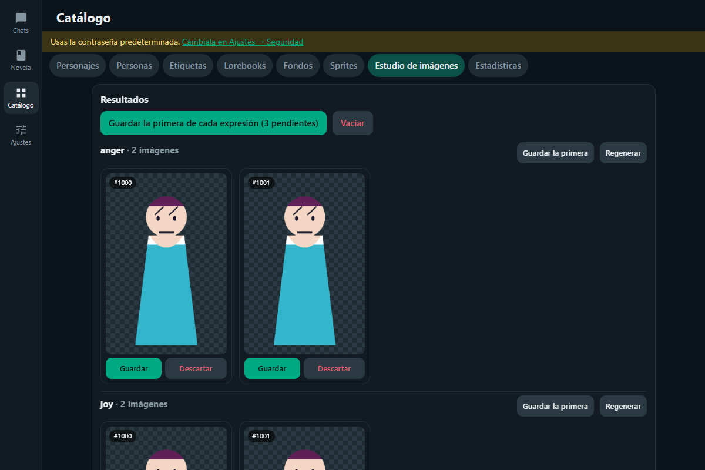<br><sub><b>Expresiones</b> con inpaint: solo cambia la cara y conserva la transparencia.</sub></td>
  </tr>
  <tr>
    <td width="50%">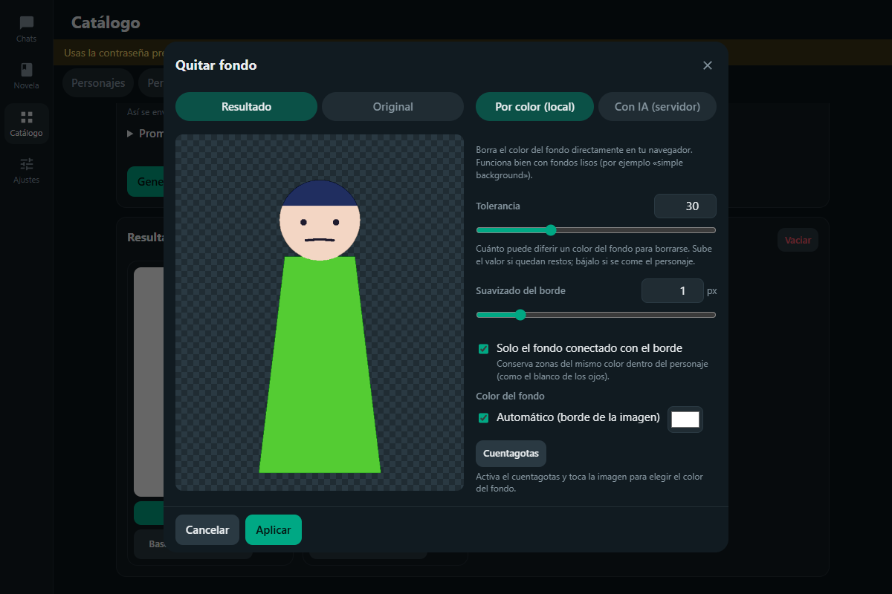<br><sub><b>Quitar fondo</b>: por color (local) o con IA (rembg).</sub></td>
    <td width="50%">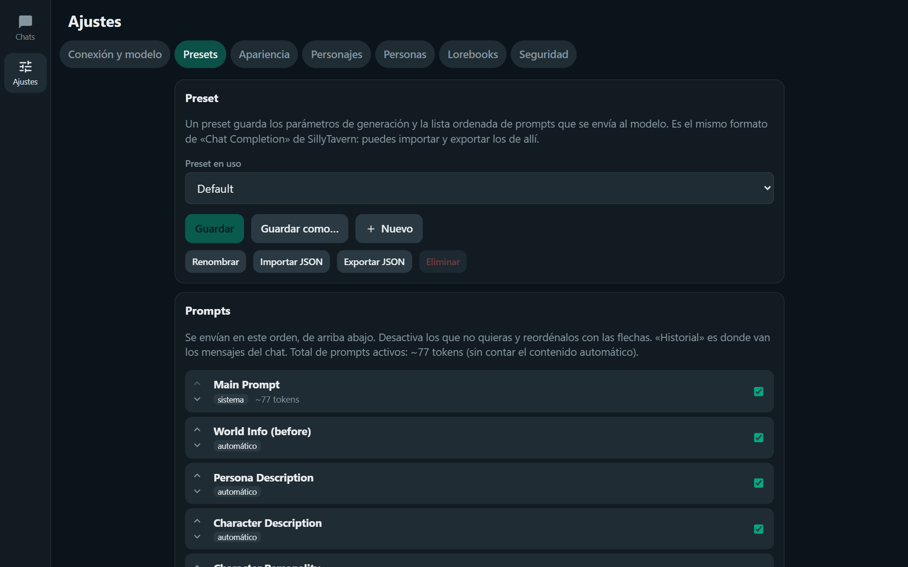<br><sub><b>Presets</b> con varios prompts, orden y activación individual.</sub></td>
  </tr>
  <tr>
    <td width="50%">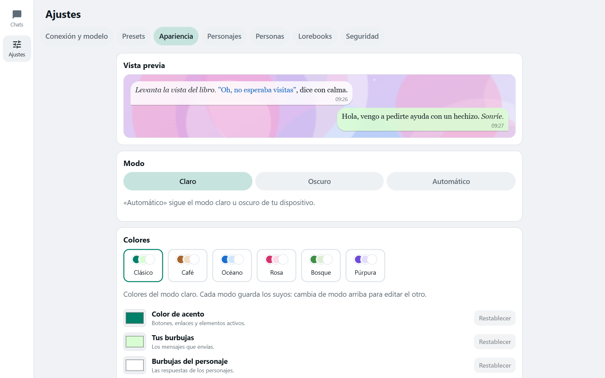<br><sub><b>Apariencia</b>: colores, fuentes, fondo y transparencia con vista previa.</sub></td>
    <td width="50%"></td>
  </tr>
</table>

## 🚀 Inicio rápido

Necesitas [Node.js](https://nodejs.org) 18 o superior.

```bash
npm install
npm run build
npm start          # http://localhost:3001 (también accesible desde tu red local)
```

Desarrollo con recarga en caliente: `npm run dev` (cliente en http://localhost:5173, API en 3001).

Primer arranque: entra con **`admin` / `Admin`** y cambia la contraseña en **Ajustes → Seguridad**. Luego, en **Ajustes → Conexión y modelo**, añade una conexión (OpenRouter con tu API key, o un servidor local compatible con OpenAI como LM Studio u Ollama) y elige un modelo. Después importa o crea un personaje en **Catálogo → Personajes** y empieza a chatear desde **Chats**.

---

# Guía detallada

## Conexiones y modelos

- Puedes guardar varias conexiones (cuentas de OpenRouter y/o servidores locales) y cambiar de una a otra; la activa se usa para generar.
- Servidor local: URL de la API compatible con OpenAI, p. ej. `http://localhost:1234/v1` (LM Studio) o `http://localhost:11434/v1` (Ollama). La URL se abre desde la máquina que ejecuta Chatpuccino.
- Cada conexión tiene sus **modelos favoritos** (estrella); también aparecen en el menú del chat → *Modelo* para cambiar rápido.

## Presets y prompts de sistema

Estilo «Chat Completion» de SillyTavern (**Ajustes → Presets**). Cada preset es un JSON en `data/presets/` que guarda:
- **Muestreo:** temperatura, top P/K/A, min P, penalizaciones, tokens máximos y contexto.
- **Lista de prompts:** varios a la vez, cada uno con rol (sistema/usuario/asistente), contenido, activo/inactivo y orden. Los hay automáticos (descripción, personalidad, escenario, persona, lorebook antes/después, ejemplos y historial) y personalizados (los que tú añades). Un prompt personalizado puede ir en su posición de la lista o «en el chat» a cierta profundidad del historial.
- **Mensajes auxiliares y formatos:** inicio de chat, aviso de grupo, formato del lorebook/escenario/personalidad y unión de mensajes de sistema.

Puedes crear, duplicar, renombrar, eliminar, importar y exportar presets (se leen los JSON de SillyTavern; solo se usa el orden global de prompts, no el de cada personaje). El preset activo se cambia también desde el menú del chat, donde **«Ver prompt que se enviará»** muestra el prompt final con tokens estimados. La tarjeta del personaje puede reemplazar el prompt principal y las instrucciones posteriores al historial (`{{original}}` conserva el del preset).

## Asistente de personajes

IA para ayudarte a crear personajes y personas, con su **propia configuración, independiente de la del roleplay** (**Ajustes → Asistente de personajes**):

- **Conexión y modelo:** OpenRouter (con key y favoritos) o un servidor local compatible con OpenAI, igual que en *Conexión y modelo*, pero separada. Opcionalmente un **modelo con visión** para la lectura de imagen; si lo dejas vacío se usa el del asistente.
- **Prompt de sistema** y **muestreo** (temperatura, Top P/K/A, Min P, penalizaciones y máximo de tokens, con los mismos rangos que los presets). También se edita la instrucción de lectura de imagen. Cada uno tiene su botón para restablecer los valores por defecto.
- Todo se guarda en **`data/assistant.jsonl`** (una línea JSON por sección: `connection`, `prompts` y `sampling`). Como `data/` y `*.jsonl` están en `.gitignore`, la API key no se sube al repositorio.

**Botón ✨ en cada bloque de texto** del creador de personajes (descripción, personalidad, escenario, primer mensaje, ejemplos de diálogo, cada saludo alternativo y los campos de *Avanzado*) y en la descripción de las personas. También está en la **premisa de los mundos** (Modo Novela), en la **descripción de las estadísticas** y en los **lorebooks**: descripción del libro y, en cada entrada, título, palabras clave (la IA las propone separadas por comas y se aplican como lista) y contenido. Abre una ventana donde eliges:

- **Generar** (desde cero), **Mejorar**, **Expandir** o **Reescribir** (los tres últimos necesitan texto en el campo; con el campo vacío solo está *Generar*).
- **Indicaciones** opcionales («más misteriosa», «tono oscuro»…).

El texto se va escribiendo en vivo en una vista previa que puedes editar; solo se aplica al campo si pulsas **Usar este texto**. El asistente recibe como contexto el resto de la ficha (nombre, etiquetas y otros campos), pero nunca repite el campo que está editando.

**Lectura de imagen:** cuadro adicional en el creador de personajes. **Leer imagen** envía la imagen del personaje al modelo con visión, que describe su aspecto físico. La descripción se guarda en la tarjeta como extensión (`extensions.image_reading`; otros programas la ignoran) y con **Añadir a la descripción** puedes pasarla a la descripción del personaje. También tiene su ✨ para mejorarla.

Si el asistente no está configurado, la ventana lo indica y enlaza a su configuración.

### ¿Respuesta vacía?

Cuando el modelo no devuelve texto (en el asistente, en los chats o en los mundos), la aplicación te explica el **motivo** y qué hacer: se quedó sin tokens (sube *Máx. tokens*), gastó todo en razonar (usa un modelo sin razonamiento), rechazó la petición (filtro de contenido) o el proveedor no devolvió datos. Además, la **consola del servidor** registra una línea `[IA] Respuesta vacía…` con el modelo, el proveedor, el motivo de fin (`finish_reason`), los caracteres de razonamiento, el uso de tokens y una muestra de lo recibido (nunca la key ni tu conversación); la consola del navegador muestra los mismos datos.

## Modo Novela

Tercera sección del menú (**Novela**): roleplay como una **novela visual**, con escena, sprites del personaje y cuadro de diálogo. Los «chats» se llaman **Mundos**.

- **Mundos:** cada mundo es una historia continua con su propio reparto, personaje(s) **en escena**, lorebooks (se eligen en un desplegable, como las etiquetas), estadísticas asociadas, fondo actual y persona opcional. Se crean con el botón **+** de la lista; puedes duplicarlos y ramificarlos.
- **Catálogo** (sección propia del menú, `/catalog`, pestañas *Personajes · Personas · Etiquetas · Lorebooks · Fondos · Sprites · Estadísticas · Estudio de imágenes*): lo que se crea una vez y se reutiliza en chats y mundos. La pestaña **Etiquetas** muestra cuántos personajes usa cada etiqueta y permite renombrarla (si el nombre ya existe, se fusionan) o quitarla de todos. Para la novela:
  - **Estadísticas:** nombre, **descripción** (qué mide y cómo debe influir; se envía a la IA), alcance (*por personaje* o *del mundo*), rango, valor inicial y color. Se asocian a los mundos desde un desplegable.
  - **Fondos:** imágenes de escenario con nombre y descripción (la IA los elige según la historia). Arrastra varias a la vez.
  - **Accesos directos** (botón de la cabecera de la lista de mundos → `/novel/library`): enlaces rápidos a Sprites, Estadísticas, Fondos, Personajes y Lorebooks del Catálogo.
  - **Sprites:** por personaje, varios **atuendos** y una imagen por **expresión** siguiendo el sistema de SillyTavern: las 28 etiquetas de emoción (`joy`, `anger`, `neutral`…), varias variantes por etiqueta (`joy.png`, `joy-2.png`), expresión de reserva y expresiones propias. Subida masiva con detección de la etiqueta por el nombre del archivo, o casilla por casilla. Si falta un sprite se usa la expresión de reserva y, en último caso, el avatar de la tarjeta. Aquí también se fijan los **valores iniciales de las estadísticas** de cada personaje.
- **Generación:** usa la conexión y el preset activos del roleplay. La IA escribe la escena como un **guion** (`[Luna|joy] texto`, `[Narrator] texto`) y, al final, un bloque de control oculto con los cambios (estadísticas, fondo, atuendos, entradas y salidas de escena). El servidor lo valida: solo estadísticas asociadas, valores dentro del rango y cambios pequeños por escena. Si el modelo omite el bloque y el mundo tiene estadísticas, hace una consulta breve de análisis. El prompt incluye las fichas de los personajes en escena, el lorebook, las estadísticas con sus valores actuales y la instrucción de que **influyan en el comportamiento y las decisiones** (afecto bajo → más fría, etc.), y las expresiones, atuendos y fondos disponibles.
- **Estadísticas:** los valores viven en cada escena (así ramificar, borrar o cambiar de variante los «rebobina»); cada cambio aparece como **notificación emergente** (`Luna · Afecto +4 (30 → 34)` con el motivo). Además se guardan en un JSON por personaje (`data/worlds/<mundo>/characters/<personaje>.json`) y puedes corregir cualquier valor a mano desde el panel.
- **Vista de novela (escritorio):** fondo, personajes de pie con la expresión de la línea actual (el que habla se resalta, los demás se atenúan) y el cuadro de diálogo debajo. Se avanza con clic, Espacio, Intro o →; ← vuelve atrás. Botones: **Responder** (abre el cuadro para escribir tu respuesta, con ✨ para que la IA la escriba), **Continuar**, **Regenerar**, variantes, editar, borrar, **ramificar**, historial. A la derecha, el panel con **fondo de la escena**, **atuendo** de cada personaje, **quién está en escena**, el reparto, las estadísticas y la edición del mundo.
- **Teléfonos:** escena arriba y diálogo debajo, con dos modos de enfoque: **texto** (la escena se reduce) y **personaje** (el diálogo se compacta); el panel se abre como hoja inferior.
- **Datos:** `data/worlds/<mundo>/` (`world.json`, `story.jsonl` en formato de chat de SillyTavern), `data/vn/stats.json`, `data/vn/backgrounds*` y `data/vn/sprites/<personaje>/`; todo dentro de `data/`, que no se sube al repositorio.

## Estudio de imágenes

**Catálogo → Estudio de imágenes** se conecta a **tu propio servidor de Stable Diffusion** (API de [AUTOMATIC1111](https://github.com/AUTOMATIC1111/stable-diffusion-webui) o Forge, iniciado con `--api`) para crear las imágenes de tus personajes y de las novelas. Chatpuccino no incluye ni descarga modelos: las imágenes se generan en tu máquina.

- **Configuración:** la **conexión** (dirección, usuario/contraseña opcionales y botón de prueba), el **modelo** (lista del servidor, **favoritos ★**, añadir uno a mano, VAE y *clip skip*), los **parámetros** de la imagen con barras deslizantes y **un perfil por tipo de imagen** (personajes, expresiones y fondos): tamaño con presets, pasos, CFG, muestreador, *scheduler*, semilla, imágenes por tanda, restaurar caras y **re-escalado** (*Hires. fix*: factor, reescalador, pasos y denoising), y los **prompts** base y negativo de cada perfil. Los prompts se escriben como etiquetas separadas por comas (`red hair, big eyes, realistic style`).
- **Personajes:** cada personaje tiene su **prompt de apariencia** (más un negativo propio). El asistente de IA (✨) lo escribe a partir de la ficha, y **«Generar prompt desde la imagen»** lo deduce de la imagen del personaje con un modelo de visión. Al generar se combinan el prompt del perfil, el del personaje y la pose/escena de la tanda. Cada resultado se puede **guardar como sprite**, usar como imagen de la tarjeta, **quitarle el fondo**, descargar o enviarlo como base para las expresiones.
- **Expresiones:** a partir de la imagen del personaje se regenera **solo la cara** con *inpaint* (img2img con máscara). La máscara es una elipse ajustable (se guarda por personaje) que se puede retocar con pincel y goma, con el dedo o el ratón. Las 28 emociones de SillyTavern traen un prompt editable; se pueden generar varias de una vez, elegir entre los candidatos y guardarlos como sprites del atuendo que elijas (compatibles con el Modo Novela).
- **Quitar fondo:** herramienta integrada, con dos métodos: **por color** (local, en el navegador: tolerancia, suavizado de borde y cuentagotas; ideal con fondo liso, que es lo que dejan los prompts `simple background, white background`) o **con IA** si tu Stable Diffusion tiene la extensión [rembg](https://github.com/AUTOMATIC1111/stable-diffusion-webui-rembg). Si la imagen base ya es transparente, la silueta se conserva sola al generar las expresiones.
- **Fondos:** genera escenarios (con ✨ para el prompt, presets de proporción 16:9, 3:2…) y guárdalos directamente en el catálogo de **Fondos** de la novela.
- **Progreso y cancelación:** se ve el paso y el tiempo estimado, y se puede cancelar (también se interrumpe la tarea en Stable Diffusion). Los resultados se conservan mientras uses el Catálogo; lo que guardes se escribe en tus sprites, fondos o tarjeta.
- **Datos:** `data/studio/config.json` (conexión, modelo y perfiles; incluye la contraseña de Stable Diffusion si la usas) y `data/studio/characters/<personaje>.json` (prompt y región de la cara).

## Importar chats

Botón ⬆ en la lista de chats: sube uno o varios `.jsonl` de SillyTavern y elige el personaje o grupo destino (se detecta por el nombre del personaje en el archivo). Cada archivo se añade como un chat nuevo.

## Apariencia

**Ajustes → Apariencia** (se aplica al instante y se guarda en el servidor, así que se ve igual en tus dispositivos):
- **Modo** claro, oscuro o automático (sigue al dispositivo).
- **Colores** de acento, de tus burbujas, de las del personaje y del fondo del chat, con paletas rápidas (Clásico, Café, Océano, Rosa, Bosque, Púrpura). Cada modo guarda sus propios colores y el texto de las burbujas se ajusta solo para mantener el contraste.
- **Fuentes** (de la interfaz y de los mensajes, por separado; incluye «otra fuente instalada») y **tamaños** de letra.
- **Burbujas:** opacidad de las tuyas y de las del personaje, desenfoque detrás de ellas y redondeo.
- **Fondo de pantalla:** una imagen detrás de los mensajes, con desenfoque y oscurecido/aclarado ajustables. Se guarda como `data/wallpaper.*` y la apariencia en `data/appearance.json` (ambos fuera de git).

## Idiomas

La interfaz está disponible en **español** e **inglés**. Se elige en **Ajustes → Apariencia → Idioma**: *Automático* usa el idioma del navegador (español si no está disponible); el cambio es instantáneo y se guarda con tu apariencia, así que se ve igual en todos tus dispositivos. También cambia el idioma de los mensajes del servidor (errores, títulos de chats copiados o ramificados…) y los prompts por defecto del asistente de personajes. El contenido que escribes (chats, personajes, presets) no se traduce.

Todos los textos están en **un archivo JSON por idioma** en la carpeta [`locales/`](locales) (`es.json`, `en.json`), compartidos por el cliente y el servidor:

- Cada archivo tiene `_meta` (`code`, `name` que se muestra en el selector y `dateLocale` para fechas) y los textos agrupados por pantalla (`chat.menu.pin`…). Los parámetros se escriben `{nombre}` y los plurales se definen con `clave_one` / `clave_other` (se usan con `{count}`).
- **Añadir un idioma:** copia `locales/en.json` (o usa *Exportar este idioma* en Apariencia), renómbralo con el código del idioma (p. ej. `fr.json`), cambia `_meta` y traduce los valores; después `npm run build`. Aparece solo en el selector. Si falta algún texto se usa el español.
- **Comprobación:** `npm run check:i18n` verifica que todos los idiomas tengan las mismas claves y marcadores y que cada clave usada en el código exista (también lo ejecuta `npm test`).

## Variantes, ramas y grupos

- **Cambiar de variante:** en el último mensaje del personaje, usa las flechas «‹ 2/3 ›» o, en pantallas táctiles, **desliza la burbuja** hacia la izquierda (siguiente) o la derecha (anterior). Si ya estás en la última variante, deslizar a la izquierda **genera una nueva**: aparece un icono de regenerar que se rellena al avanzar y, al pasar el umbral (se activa con una vibración corta), basta soltar. Si sueltas antes, no pasa nada, así no gastas tokens por accidente. El scroll vertical del chat no se ve afectado.
- **Eliminar una variante:** en el último mensaje del personaje, el botón rojo 🗑 junto a «‹ 2/3 ›» borra solo la variante que estás viendo; el mensaje conserva las demás (la última no se puede quitar: borra el mensaje).
- **Ramificar:** toca un mensaje → *Ramificar*. Se crea un chat nuevo con una copia de la conversación hasta ese mensaje (inclusive), enlazado al original (`main_chat` en el `.jsonl`) y titulado «… (rama)». El original no cambia.
- **Impersonar:** el botón ✨ junto a *Enviar* pide al modelo que escriba un mensaje **como tú** (según tu persona y el contexto) y lo va escribiendo en la caja de texto; lo revisas, lo editas y lo envías tú. Si ya habías escrito algo, se usa como inicio. No se guarda nada en el chat hasta que envías, y puedes detenerlo con el mismo botón. La instrucción que se envía es editable en *Presets → Mensajes auxiliares* («Impersonar»).
- **Fijar chats:** ⋮ de un chat (en la lista o dentro del chat) → *Fijar chat*. Los fijados aparecen arriba, en su propia sección «Fijados» y con un icono de pin; dentro de cada sección siguen el orden por actividad reciente. Fijar no modifica el archivo del chat (se guarda en los ajustes), y la copia de un chat fijado no queda fijada.
- **Copiar chat:** menú ⋮ de un chat (en la lista o dentro del chat) → *Copiar chat*. Duplica la conversación completa como un chat independiente («… (copia)»); el original no cambia.
- **Tarjeta del personaje:** en un chat individual, toca el nombre del personaje en el encabezado; en un grupo, toca su nombre sobre cualquier mensaje. Se abre la tarjeta completa para verla y editarla (nombre, descripción, saludos, lorebook, imagen…) sin salir del chat. Al guardar, el cambio se aplica a las siguientes respuestas.
- **Persona activa:** botón en la esquina inferior izquierda de la lista de chats (avatar + nombre). Su menú lista tus personas (✓ la activa), permite **editar** la actual o crear una nueva sin salir de Chats. Si tienes un chat abierto, elegir una persona la aplica a ese chat y además la deja como predeterminada para los chats nuevos; sin chat abierto solo cambia la predeterminada.
- **Nombres automáticos:** `{{user}}` se muestra como el nombre de la persona activa del chat o mundo y `{{char}}` como el del personaje que habla (también `<USER>` y `<BOT>`), tanto en mensajes del chat como en el Modo Novela, en los textos del modelo y en los tuyos. También se sustituyen en el historial que se envía al modelo. El archivo del chat conserva el texto original, así que si cambias de persona o renombras al personaje, los mensajes antiguos se actualizan.
- **Convertir en grupo:** menú del chat individual → *Convertir en grupo…*. Elige los demás personajes y el modo de respuesta; el chat pasa al grupo con todo su historial (o se copia, si marcas «Conservar también el chat original»).

## Seguridad

- Inicio de sesión con cookie firmada (30 días), contraseña con scrypt y bloqueo progresivo tras 5 intentos fallidos.
- Desde **Ajustes → Seguridad** puedes cambiar usuario/contraseña, cerrar sesiones en todos los dispositivos o desactivar el login (no recomendado fuera de un equipo de confianza).
- Los datos de acceso están en `data/auth.json`. Si olvidas la contraseña, borra ese archivo y reinicia: vuelve `admin` / `Admin`.
- Usa HTTPS (proxy inverso) si accedes desde fuera de tu red local: la cookie se marca `Secure` automáticamente tras un proxy que envíe `X-Forwarded-Proto: https`.

Variables opcionales: `PORT`, `HOST` (por defecto `0.0.0.0`), `DATA_DIR` (por defecto `./data`), `OPENROUTER_API_KEY` (solo se usa para crear la conexión inicial).

## Datos (`data/`)

| Ruta | Contenido |
| --- | --- |
| `characters/<Nombre>.png` | Tarjetas de personaje: PNG con los metadatos `chara` (V2) y `ccv3` (V3), igual que SillyTavern |
| `chats/<Personaje>/<archivo>.jsonl` | Un archivo por chat; cada chat tiene su propia historia |
| `groups/<id>.json`, `group-chats/<id>/*.jsonl` | Grupos y sus chats |
| `personas/<id>.json` + `.png` | Personas (tu representación) |
| `lorebooks/<nombre>.json` | Lorebooks en formato World Info de SillyTavern |
| `presets/<nombre>.json` | Presets de generación y prompts (formato Chat Completion de SillyTavern) |
| `assistant.jsonl` | Configuración del asistente de personajes: conexión (con API key), prompts y muestreo |
| `studio/` | Estudio de imágenes: `config.json` (servidor de Stable Diffusion, modelo, perfiles) y `characters/<id>.json` (prompt y región de la cara) |
| `settings.json` | Conexiones (API keys, modelos, favoritos) y parámetros |
| `auth.json` | Usuario, hash de la contraseña y secreto de sesión |

Puedes copiar tarjetas PNG, chats `.jsonl` y lorebooks desde una instalación de SillyTavern a estas carpetas (o importarlos desde la interfaz).

## Pruebas

`npm test` levanta el servidor contra un OpenRouter simulado y valida PNG, lorebooks, chats, streaming, swipes y grupos.

## Contribuir

Chatpuccino es de código abierto y toda ayuda suma: corregir un error, mejorar una traducción o la documentación, proponer una función o probarlo en tu dispositivo y contar cómo te fue.

1. Haz un *fork* del repositorio y crea una rama para tu cambio.
2. Instala las dependencias con `npm install` y arranca el entorno de desarrollo con `npm run dev`.
3. Si tocas el servidor, añade o ajusta pruebas en `server/test/` y comprueba que `npm test` pasa; si tocas la interfaz, verifica que `npm run build` compila. Los textos visibles van en `locales/*.json` (nunca escritos a mano en el código): usa `t('area.clave')` y añade la clave en todos los idiomas; `npm run check:i18n` te avisa de lo que falte.
4. Abre un *pull request* describiendo qué cambia y por qué (las capturas ayudan mucho en cambios visuales).

Para reportar un fallo o proponer una idea, abre un *issue* con los pasos para reproducirlo, qué esperabas que pasara y, si puedes, tu sistema y navegador.

### Estructura del proyecto

| Carpeta | Contenido |
| --- | --- |
| `client/` | Interfaz React (Vite): páginas de chats y ajustes, componentes y tema |
| `locales/` | Idiomas de la interfaz y del servidor (un JSON por idioma) |
| `shared/` | Código compartido por cliente y servidor (guion y expresiones del Modo Novela) |
| `server/` | API Express: tarjetas PNG, chats JSONL, lorebooks, presets, conexiones y autenticación |
| `server/test/` | Pruebas de integración (`node --test`) |
| `docs/screenshots/` | Capturas usadas en este README |
| `data/` | Tus datos locales (ignorados por git: llaves, chats y credenciales nunca se suben) |

### Datos sensibles

El archivo `.gitignore` excluye `data/`, llaves, chats y credenciales. Antes de abrir un *pull request*, revisa que no incluyes API keys, chats personales ni capturas con información privada.

## Agradecimientos

Gracias al proyecto [SillyTavern](https://github.com/SillyTavern/SillyTavern) por definir los formatos de tarjetas, lorebooks y chats que Chatpuccino reutiliza para que tus personajes viajen contigo.
